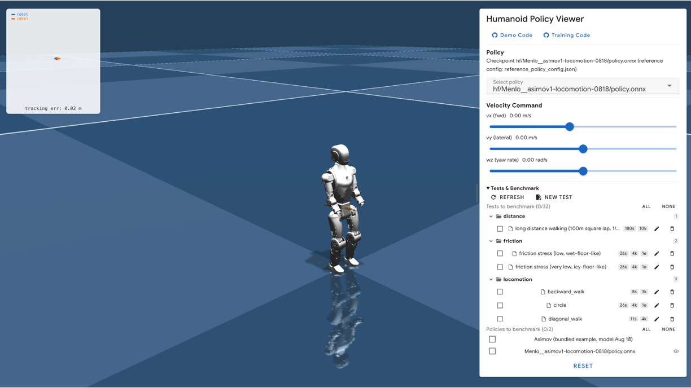

# Humanoid Policy Viewer



A browser-based viewer and test bench for humanoid locomotion policies. It runs
a MuJoCo WebAssembly simulation of the [Asimov](https://github.com/menloresearch/asimov-1)
robot and drives it with an ONNX policy through onnxruntime-web, so a trained
policy can be tried without a GPU or a training stack.

- **Try a policy:** load one from Hugging Face with a single command, from a
  local policy library, or use the bundled example.
- **Drive and stress it:** set velocity commands, push the robot, and change
  friction, armature, gains, gravity and other physical parameters live.
- **Score it:** `npm run benchmark <policy>` runs a benchmark (locomotion,
  pushes, friction, long walks) from a local folder or a Hugging Face dataset,
  on your machine. Build your own benchmark in the app's Tests & Benchmark
  panel: tests, repeats, seeds and leaderboard tasks.
- **Reads from Hugging Face, never writes:** policies and benchmarks are
  downloaded; publishing a benchmark and submitting results to the Hub
  leaderboards are done with [cyclotron](https://github.com/menloresearch/cyclotron),
  which uses this viewer as its benchmark harness.
- **Faithful setup:** the robot is the canonical `asimov-1` model, and each
  policy's gains, action scale and torque limits are read from its training
  `env.yaml`, so what you see matches how it was trained.

To train your own policy, use [cyclotron](https://github.com/menloresearch/cyclotron).
See [Supported policies](docs/huggingface.md#supported-policies) for the
inputs and outputs the viewer expects.

## Quick start

Run a policy from Hugging Face use the format `npm run hf <policy>`

For Example:
```bash
npm run hf Menlo/asimov1-locomotion-0818
```

`<policy>` is the Hugging Face repo id (`org/name`) or its URL. This works straight
from a fresh clone: it installs dependencies, fetches the Asimov robot model,
downloads the policy and opens the viewer with it selected. It needs Node, `git`
and `bash`. See [Run a policy from Hugging Face](docs/huggingface.md).

`<policy>` can also be a folder or `.onnx` file on disk holding the same files,
for example `npm run hf ./my-policy`; see
[Run a policy from a folder](docs/huggingface.md#run-a-policy-from-a-folder).
Give several policies, or a folder of them (such as a training run's logs), to
list them all in the viewer's policy dropdown: `npm run hf ./logs Menlo/asimov1-locomotion-0818`.
A benchmark can be given in any order beside them: `npm run hf <policy> datasets/<org>/<name>`
opens a Hub benchmark (read-only), `npm run hf <policy> ./my-benchmark` a local one.

## Run local policies

To run policies you have on disk, or to work on the viewer itself:

```bash
npm run dev                  # start the viewer on the bundled example policy
npm run dev ./logs           # ... also listing every policy folder below ./logs
```

Like `npm run hf` and `npm run benchmark` (which also installs Chromium), it
installs the dependencies and fetches the Asimov robot model on the first run. Then open the printed URL. It opens the example
benchmark `benchmarks/default/` in the Tests & Benchmark panel; give
`benchmark=<dir>` for another. To add your own policy, put it in a folder under
`policies/` (git-ignored, and not built into `dist/`):

```
policies/my-policy/
├── policy.onnx
├── env.yaml       the training run's gains, action scale and torque limits
└── agent.yaml
```

It appears in the policy dropdown the next time the page loads. To serve
policies from somewhere else, see [Policy library](docs/policy-library.md).

`npm run dev` listens on all network interfaces, so other machines on your
network can reach it, and does not open a browser. `npm run hf` listens on
localhost only and opens the browser. Both take `port=<n>`.

## Where policies come from

Every policy the viewer can run appears in its policy dropdown. They come from
these sources:

| Source | Where the files are | How you get it |
|---|---|---|
| Bundled example | `public/examples/checkpoints/asimov/model_aug_18_1/`, in this repo | The default with `npm run dev` |
| Hugging Face | `~/.cache/humanoid-policy-viewer/hf/<org>__<name>/`, outside the repo | `npm run hf <policy>`, or `npm run dev <policy>`; `npm run dev` lists every one already downloaded |
| Local folder | `policies/<name>/` in this repo (git-ignored), or wherever `HPV_POLICY_LIBRARY_DIR` and `HPV_POLICY_ROOTS` point | Put the files there, then `npm run dev` |
| Any folder on disk | Wherever it is; linked, not copied | `npm run hf <folder>` or `npm run dev <folder>`; a folder of policies lists every policy folder below it |

In every case the gains, action scale and torque limits come from the `env.yaml`
next to the `.onnx`; see [Policy config](docs/policy-config.md). The robot is the
same everywhere: the `asimov-1` submodule.

## Docs

| Topic | |
|---|---|
| [Run a policy from Hugging Face](docs/huggingface.md) | `npm run hf`: options, private repos, where downloads are cached |
| [Policy config](docs/policy-config.md) | What `reference_policy_config.json` and a policy's `env.yaml` each control, and which wins |
| [Policy library](docs/policy-library.md) | Serving policies from outside `public/` (`HPV_POLICY_*` variables) |
| [Benchmarking](docs/benchmarking.md) | `npm run benchmark`: running a benchmark, reading results, versions, parallelism |
| [Benchmarks](docs/benchmarks.md) | The benchmark format (tests, `benchmark.yaml`, metrics), creating and changing one, and the `inspect` command publishing tools read |
| [Adding a robot](docs/adding-a-robot.md) | Bringing your own MJCF, policy and motion clips |
| [Architecture](docs/architecture.md) | How the app, server and commands fit together; words; every `HPV_*` environment variable; old → new names |
| [Scenes](public/examples/scenes/README.md) | The `asimov-1` submodule and how actuators are added at load |

## Project structure

- `src/views/Demo.vue` - UI controls for the live demo
- `src/simulation/main.js` - bootstraps MuJoCo, Three.js renderer, policy loop, and metric sampling hook
- `src/simulation/mujocoUtils.js` - scene/policy loading utilities and filesystem preloading
- `src/simulation/policyRunner.js` - ONNX inference wrapper and observation pipeline
- `public/examples/scenes/` - MJCF files + meshes staged into MuJoCo's MEMFS; the Asimov robot is the `asimov-1/` git submodule
- `public/examples/checkpoints/` - policy config JSON, bundled ONNX files, and motion clips
- `src/views/BenchmarkResults.vue` - the results page (charts, per-repeat outcomes, tasks)
- `scripts/` - the commands: `dev.mjs`, `hf.mjs`, `run-benchmark.mjs`, and `inspect.mjs` (a benchmark folder or a policy as JSON, for publishing tools)
- `scripts/startViewer.mjs`, `scripts/viewerServer.mjs` - how every command starts the dev server, and the server's routes (`/api/...`, `/policy-library/`)
- `src/benchmark/` - benchmark protocol, test-row and `benchmark.yaml` formats, scoring; `run.js` plans cells and builds `result.json` for both the CLI and the in-app Run, and `resultView.js` turns a `result.json` into what the results page and `report.html` show
- `benchmarks/` - local benchmarks: `default/` (tracked; what `npm run dev` opens and what new benchmarks are copied from), and, gitignored, benchmarks made with the app's **New benchmark**
- `benchmark_results/` - (gitignored) saved benchmark results
- `test/fixtures/smoke-benchmark/` - a tiny benchmark for tests and the golden check
- `test/browser/` - tests that drive the viewer in headless Chromium (`npm run test:browser`, not part of `npm test`), on `test/fixtures/viewer-run-benchmark/`
- an optional [policy library](docs/policy-library.md) served by local Vite middleware under `/policy-library/`

## License and acknowledgements

This repository is a fork of `humanoid-policy-viewer` by
[Qingzhou Lu (Axellwppr)](https://github.com/Axellwppr), a motion-tracking viewer for the Unitree G1, and still carries that viewer's G1
scene and motion-tracking code. The upstream project's demos:
[Humanoid Policy Viewer](https://motion-tracking.axell.top/),
[GentleHumanoid Web Demo](https://gentle-humanoid.axell.top/).

Both the original project and Menlo Research's additions are licensed under the
[BSD 3-Clause License](LICENSE):

- **Original code**, author-created motions, and the author-trained policy
  weights at `public/examples/checkpoints/g1/policy_latest.onnx` — copyright
  © 2026 Qingzhou Lu.
- **Menlo Research modifications** — changes made after upstream commit
  `0490320`, including Asimov support, the benchmark, and Hugging Face
  model loading — copyright © 2026 Menlo Research Pte. Ltd.

Third-party code, libraries, robot descriptions, meshes, and third-party motion
data are not relicensed by this grant. They remain subject to their respective
terms; see [Third-party notices](THIRD_PARTY_NOTICES.md) for sources and scope.
This includes the Asimov robot description in the `asimov-1` submodule, which is
licensed under CERN-OHL-S-2.0.

This viewer builds on MuJoCo, the MuJoCo WASM community, Three.js, ONNX Runtime,
Vue, and Vuetify. We also thank Unitree Robotics and the creators of the motion
datasets used in the examples. If you build on this viewer, a link back to this
repository is appreciated.
