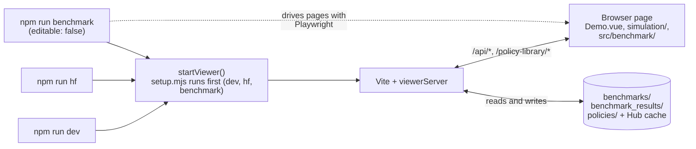
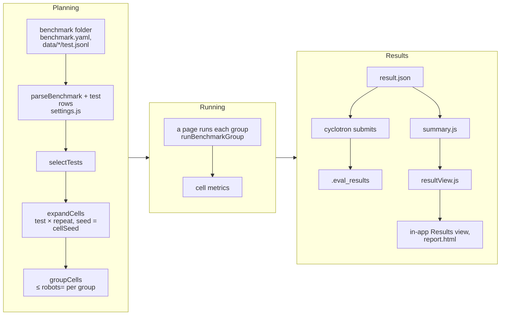

# Architecture

> The old names were dropped without aliases; the [migration table](#migration-from-the-old-names) maps
> each one to its replacement.

The viewer is a single browser app: Vue, MuJoCo compiled to WebAssembly, and an ONNX policy run by
onnxruntime-web. A small Node server sits beside it as a Vite plugin. It serves policies from disk, reads and
writes local benchmark folders (a benchmark downloaded from the Hub is only read), and stores results. Every command starts the same server the same way, and every
benchmark run, whether it starts in the app or from the command line, goes through the same run engine and
saves the same `result.json`.

## Words

| Word | Meaning |
|---|---|
| **policy** | A trained controller: an `.onnx` file plus the `env.yaml` it was trained with. It can live on the Hub (a Hugging Face model repo), in a local folder, or be the bundled example. |
| **benchmark** | A folder with `benchmark.yaml` (settings) and `data/<config>/test.jsonl` (tests). On the Hub it is stored as a dataset repo. |
| **test** | One scenario: commands over time, pushes, terrain, friction, and an end zone (`goal`). A test is one row of a `test.jsonl`. |
| **config** | A group of tests, stored as one `data/<config>/test.jsonl` file. It is also a Hugging Face dataset config. The app calls it a category. |
| **repeat** | One of a test's runs. Repeats differ only in their seed: action delay, joint noise and the other randomisation. |
| **cell** | One repeat of one test for one policy. It is the unit of work and of the raw results. |
| **group** | The repeats of one test that a page runs at the same time, as robots side by side in one scene (at most `robots=`). |
| **result** | The saved outcome of running a benchmark: `benchmark_results/<timestamp>/result.json` and `report.html`. "Run" is only ever a verb. |
| **metric** | A number measured per cell, such as `survival_rate` or `survival_time`. |
| **task** | A leaderboard number the benchmark defines, such as `push_walking_survival_rate_v1`: one metric, aggregated over a set of tests and their repeats, with a 95% interval. Each task is one leaderboard on the Hub. |
| **protocol** | `BENCHMARK_PROTOCOL` in `src/benchmark/protocol.js`. It is bumped by any viewer change that can move a number. |
| **sequence** | Only the runtime command timeline that a test is turned into (`commandSequencer`, `rowToSequence`). A stored scenario is a test. |

## Commands

Nothing uploads: the viewer only reads from the Hugging Face Hub (policies and benchmarks). Publishing a benchmark
and submitting results are done with [cyclotron](https://github.com/menloresearch/cyclotron), which uses this
viewer as its benchmark harness and reads benchmarks through `inspect`.

```
npm run hf <policy>... [<benchmark>] [port=] [no-open]   first-run setup, then the viewer on localhost with the first policy open
npm run dev [<policy>...] [<benchmark>] [port=<n>]       viewer on all interfaces, no browser opened
npm run benchmark <policy>... [<benchmark>] [tests= repeats= jobs= robots= shard= out= watch force verbose]
                                                 result -> benchmark_results/<timestamp>/; never uploads
npm run benchmark init <dir>                     new benchmark, a copy of benchmarks/default (or HPV_BENCHMARK_TEMPLATE)
npm run benchmark path-end <dir> [<test id>...]  where each test's path ends, for placing an end zone
npm run benchmark merge <result dir...> [out=]   combine shards into one result
npm run benchmark view <result dir> [port=] [no-open]   the viewer's results page on a result (same as /?result=<folder>/result.json)
npm run -s benchmark inspect <dir> [<commit>]    a benchmark folder as JSON for publishing tools (node scripts/inspect.mjs benchmark ...)
npm run -s benchmark policy-info <path>          a policy's .onnx, file hashes and problems as JSON (node scripts/inspect.mjs policy ...)
npm run benchmark:golden [update]                check a smoke run against test/fixtures/smoke-benchmark/golden.json
npm run test:browser                             the viewer in headless Chromium (test/browser/); not part of npm test
```

`npm run hf pull | diff | baseline | publish | release | submit` are gone; each prints one line pointing to
cyclotron.

This one must always work from a fresh clone, because Hugging Face links to it:

```bash
git clone https://github.com/menloresearch/humanoid-policy-viewer
cd humanoid-policy-viewer
npm install
npm run hf Menlo/asimov1-locomotion-0818
```

### How words are read

Every command takes plain words and `key=value` words, never `--flags`: npm swallows `--x` unless a bare `--`
comes first. A swallowed flag is reported with the words form to use instead.

| Word | Is |
|---|---|
| `org/name`, `org/name@rev`, a model URL | a policy on the Hub |
| `datasets/org/name`, `datasets/org/name@rev`, a dataset URL | a benchmark on the Hub |
| a folder with an `.onnx` and `env.yaml`, or an `.onnx` file | a local policy |
| a folder with no `.onnx` of its own (`hf`, `dev`) | every policy folder below it (an `.onnx` with an `env.yaml`) |
| a folder with a `benchmark.yaml` | a local benchmark |
| a first word with no `/` that names a sub-command (`benchmark`: `merge`, `view`, `init`, `path-end`, `inspect`, `policy-info`) | that sub-command |

Policies and the benchmark can come in any order (`splitTargets` in `scripts/benchmarkTargets.mjs`). All three
commands also take `policy=` (repeatable) and `benchmark=`, for a word that could be read as the other. Without a
benchmark word, every command uses `benchmarks/default`.

## The pieces



| Piece | File | Job |
|---|---|---|
| First-run setup | `scripts/setup.mjs` | Fetches the `asimov-1` robot (`init-asimov-1.sh`), and runs `npm ci` if `node_modules` is missing. It has no dependencies, so it runs before anything is installed. `dev` and `hf` call it from their own script; `npm run benchmark` goes through `scripts/benchmark.mjs`, which calls it and then imports `run-benchmark.mjs`. It skips the robot for `merge`, `init` and `path-end`, and for a run it also installs Chromium (`setupBrowser`, after the dependencies) when Playwright has none. |
| Start-up | `scripts/startViewer.mjs` | `startViewer({policies, benchmark, policyLibrary, resultsDir, host, port, open, editable, logLevel})`. It resolves the words (downloading Hub policies and benchmarks into the cache, linking local policies into a temporary library), starts Vite in-process with the server plugin, and returns `{server, url}`. `policyLibrary` (`{dir, roots, labels}`) replaces the default library: `hf` passes the policies it was given, the runner a temporary folder of links. Every launcher calls it (`dev`, `hf <policy>`, a benchmark run and `benchmark view`). |
| Policies to view | `scripts/viewPolicies.mjs`, `scripts/localPolicy.mjs` | The policies `hf` and `dev` were given: Hub ones downloaded, folders of policies expanded, local ones linked into a temporary library, each labelled by its shortest distinguishing path. |
| Server | `scripts/viewerServer.mjs` | The Vite plugin `viewerServer(options)`: the [routes](#server-routes). Its options are `{benchmarksDir, benchmarkTemplate, openBenchmark, resultsDir, logDir, policyLibraryDir, policyRoots, policyLabels, editable}`. `vite.config.mjs` fills them from `HPV_*` env vars for plain `npx vite`; the launchers pass them directly. |
| Launchers | `scripts/dev.mjs`, `scripts/hf.mjs`, `scripts/run-benchmark.mjs` | Parse words with `scripts/cliArgs.mjs` `parseWords` and `splitTargets`, then call `startViewer`. |
| Hub (read only) | `scripts/hfPolicy.mjs`, `hfDataset.mjs`, `hfAuth.mjs` | Download policies and benchmarks into the cache, with the token for private repos. Nothing writes to the Hub. |
| Inspection | `scripts/inspect.mjs` | A benchmark folder or a policy as JSON, for publishing tools ([Benchmarks](benchmarks.md#inspecting-a-benchmark-for-publishing)). Offline: no robot model, browser or network. |
| App | `src/views/Demo.vue`, `src/simulation/` | The scene, the policy loop, commands and pushes, the robots of a group, the panels. |
| Benchmark logic | `src/benchmark/` | Pure code with no Node APIs, so the app and the CLI share it: `settings.js` (`parseBenchmark`, `selectTests`, `expandCells`), `rng.js` (`cellSeed`), `run.js` (`groupCells`, `buildJobs`, `mergeResults`, `RESULT_SCHEMA`), `summary.js` (`summarizeTests`, `computeTasks`), `resultView.js` (the tables both result views draw), `protocol.js`. |
| Stores | `src/state/testStore.js`, `resultStore.js`, `policyStore.js` | The app's clients for the routes, or for `/static-data/*` in a static build. |

### Three ways the app runs

| Mode | Started by | Server | Editing |
|---|---|---|---|
| Dev server | `npm run dev`, `npm run hf` | `viewerServer`, `editable: true` | Tests, benchmark settings and new benchmarks are saved to disk, except in a benchmark downloaded from the Hub, which is read-only. |
| Headless run | `npm run benchmark` (Playwright, one Chromium process per page) | `viewerServer`, `editable: false` | None. The runner calls `window.__runBenchmarkGroup` and collects cells. |
| Static build | `vite build --mode static` (used by the site that embeds the viewer) | None. The stores read `/static-data/*.json` | None. The editing controls are hidden. |

## Server routes

`?benchmark=<key>` picks a listed benchmark folder; without it, the open one (`openBenchmark`) is used. Routes
marked ✎ exist only when `editable` is on. A benchmark downloaded from the Hub (its folder holds `.hf-dataset.json`)
is read-only even then: PUT and DELETE on its tests and its `benchmark.yaml` answer 403, pointing to cyclotron to
edit and publish it.

| Route | Methods | Does |
|---|---|---|
| `/api/benchmarks` | GET, POST ✎ | Lists the open benchmark and every folder in `benchmarks/`, each with `readOnly` and, for a Hub download, `hub` (`{id, revision, sha}`). POST creates `benchmarks/<name>/` from the starter (`benchmarks/default`, or `HPV_BENCHMARK_TEMPLATE`), with no tests. |
| `/api/benchmark/dataset?benchmark=` | GET | `benchmark.yaml` parsed, with every test row: what the in-app Run plans its cells from. |
| `/api/benchmark?benchmark=` | GET, PUT ✎ | The `benchmark.yaml` text and its form fields (the ⚙ Benchmark settings dialog). PUT refuses an edit that `npm run benchmark` would reject, or one based on a stale copy. |
| `/api/tests?benchmark=[&file=<config>/<name>.json]` | GET, PUT ✎, DELETE ✎ | Lists the tests, or reads, writes or deletes one row of `data/<config>/test.jsonl`. |
| `/api/policies` | GET | The policies in the policy library: local folders and downloaded Hub policies. |
| `/policy-library/<path>` | GET | Policy files (`.onnx`, `env.yaml`), confined to the library roots. |
| `/api/results[?file=]` | GET, POST ✎, DELETE ✎ | Lists `benchmark_results/*/result.json`, or reads one. POST saves a result from the in-app Run: the server writes `benchmark_results/<timestamp>/{result.json,report.html}` and adds the provenance the browser cannot know (viewer commit, clean checkout, versions). |
| `/api/save-log` | POST ✎ | Debug dumps into `logs/` (gitignored; `HPV_LOG_DIR` moves it). |

The app reads two query parameters when it starts (`Demo.vue`): `?policy=lib:<path>` selects a policy from the library
(`npm run hf` opens it), and `?result=<folder>/result.json` opens that saved result's page (`npm run benchmark view`
opens it; it works on any server that lists the result).

The static build serves the same data as files: `/static-data/policies.json`, `/static-data/tests.json`,
`/static-data/results.json` (the listing) and `/static-data/result.json` (one result).

## From benchmark to leaderboard



- **Planning** is the same everywhere. The settings choose the tests and how many repeats each gets. A cell's seed
  comes from the benchmark seed, the test id and the repeat index, never from run order, so the cells are the
  same whatever the job count, the `robots=` value or the shards.
- **Running:** a page loads the policy once and steps one simulation state per robot of a group. Headless, it
  steps as fast as the CPU allows. In the app it runs in real time with the robots visible. `watch` is the
  headless runner shown in real time.
- **The in-app Run** plans and runs exactly like `npm run benchmark`, so the same benchmark gives the same cells.
  It always uses the benchmark's own settings: every repeat, with randomisation.
- **Results** keep three layers: the cells (raw metrics), the per-test values and means, and the tasks. Only tasks
  are single numbers.
- **Views:** `resultView.js` turns a `result.json` into tables per policy: each test's repeats (passed, fell at
  *T* s, or missed the end zone by *D* m), the metric means, and the tasks with their intervals. The app's Results
  view (with charts) and `report.html` both draw those tables.

## Benchmarks on disk and on the Hub

```
benchmarks/<name>/
├── benchmark.yaml            settings: name, version, protocol, seed, repeats, randomisation, tests, tasks
├── data/<config>/test.jsonl  the tests, one row each
├── calibration/*.json, tools/*, [A-Z_]*.md   optional, published as is
└── .hf-dataset.json          only in a download from the Hub: the dataset and commit (makes it read-only)
```

`benchmarks/default/` is tracked in git: `npm run dev` opens it, `npm run benchmark init` copies it, and changes
to it show up in `git diff`. All other folders in `benchmarks/` are git-ignored, as are the ones made with
**New benchmark**. A benchmark from the Hub is downloaded into the cache, `hf-datasets/<org>__<name>/<commit>/`,
and run or shown from there, read-only.

**On the Hub**, a benchmark is a dataset repo. It holds the folder's files plus two the publisher generates:
- `eval.yaml` declares one task per leaderboard, `<id>_v<version>` (`taskDescriptors`). A new version gets new
  leaderboards, and the older task ids are kept so old results stay listed.
- `README.md` is the dataset card, with one dataset config per test config, plus `all` (`cardFrontMatter`).

**Publishing** is done with [cyclotron](https://github.com/menloresearch/cyclotron). It reads the folder through
`inspect` (the checks, `scored_hash`, the card front matter, the tasks and the exact files to upload, with
`harness.tested_commit` set to the viewer commit), requires a version bump when `scored_hash` changed, and tags
each release `v<version>`. Policies are benchmarked against a tag (`datasets/org/name@v2`), never a moving `main`.

**Leaderboards** are built by the Hub, not by this repo. It collects every model repo's `.eval_results` entries
that name a task in the dataset's `eval.yaml`. A dataset shows leaderboards only once its `evaluation_framework` is
in Hugging Face's list and the dataset is allow-listed; see
[Hugging Face eval results](https://huggingface.co/docs/hub/eval-results).

## Results

```
benchmark_results/<timestamp>/
├── result.json     schema hpv-benchmark-result/1
└── report.html
```

`result.json` holds:
- `provenance`: viewer commit and whether the checkout was clean, protocol, `asimov-1` commit, library and
  Chromium versions;
- `benchmark`: where it came from (Hub id and commit, or a path), the settings file, `raw` settings and the test
  rows;
- `policies[]`: for each, its `key` (which `cells[].policyKey` refers to), the Hub id and commit, and the sha256 of the `.onnx` and `env.yaml`;
- `cells[]`: seed, action delay drawn, commands actually sent, and every metric;
- `perTest` and `tasks`;
- `overrides` (`tests=`, `repeats=`) and `shard`.

The viewer does not submit results; cyclotron does, judging only what `result.json` recorded when the benchmark
ran. A result can be submitted only with a Hub policy and a Hub benchmark pinned to a commit, a clean checkout, a
matching protocol, the whole benchmark with no overrides and no unmerged shard, and no failed cell.

## Folders and environment

| Path | Tracked | Holds |
|---|---|---|
| `benchmarks/default/` | yes | The example benchmark. |
| `benchmarks/*` | no | Your benchmarks. |
| `benchmark_results/` | no | Results, one folder each. |
| `logs/` | no | Debug dumps the app saves (`/api/save-log`). |
| `policies/` | no (except `README.md`) | Local policies, one folder each. |
| `~/.cache/humanoid-policy-viewer/hf/`, `hf-datasets/` | — | Downloaded Hub policies, and Hub benchmarks (read-only). |
| `public/policy-library/`, `public/static-data/` | no | Written by an embedding site's static build. |
| `test/fixtures/smoke-benchmark/` | yes | A tiny benchmark for tests and the golden check. |
| `test/browser/`, `test/fixtures/viewer-run-benchmark/` | yes | Tests that drive the viewer in headless Chromium (`npm run test:browser`), and their benchmark. |

### Environment variables

Every variable the viewer reads, in one place. Paths are best given absolute (a relative one resolves against the
working directory). The defaults are inside this checkout, so a repo that embeds the viewer sets them to keep its
own files elsewhere.

| Variable | Default | Sets |
|---|---|---|
| `HPV_BENCHMARKS_DIR` | `benchmarks/` | where benchmark folders are listed and **New benchmark** creates them |
| `HPV_BENCHMARK_TEMPLATE` | `benchmarks/default/` | the benchmark **New benchmark** and `npm run benchmark init` copy |
| `HPV_BENCHMARK_RESULTS_DIR` | `benchmark_results/` | where results are listed and saved, by the app and by `npm run benchmark` (its default `out=` and `merge`'s) |
| `HPV_LOG_DIR` | `logs/` | where `/api/save-log` writes the app's debug dumps |
| `HPV_POLICY_LIBRARY_DIR`, `HPV_POLICY_ROOTS` | `policies/` + the Hub cache | the policy library ([Policy library](policy-library.md)) |
| `HPV_CACHE_DIR` | `~/.cache/humanoid-policy-viewer` (or `$XDG_CACHE_HOME/humanoid-policy-viewer`) | downloads: `hf/` policies, `hf-datasets/` benchmarks |
| `HF_TOKEN` | the token `hf auth login` saved (`HF_TOKEN_PATH`, else `$HF_HOME/token`, else `~/.cache/huggingface/token`) | reading private Hub repos (`scripts/hfAuth.mjs`); never used to write |
| `HF_ENDPOINT` | `https://huggingface.co` | the Hub to download from |

`HPV_BENCHMARK_RUNS_DIR`, `HPV_MODEL_LIBRARY_DIR` and `HPV_MODEL_ROOTS` still work, with a warning (see below).

## Migration from the old names

There are no aliases, except for the three environment variables below: an old name stops working when it is
renamed.

| Old | New |
|---|---|
| **Commands** | |
| `npm run hf <model> -- --revision <rev> --port <n> --no-open` | `npm run hf <policy>@<rev> port=<n> no-open` |
| `node scripts/run-hf-model.mjs …` (what cyclotron's `--view` runs) | `node scripts/hf.mjs …`, same words as `npm run hf` |
| `npm run dev suite=<x> model=<m>` | `npm run dev <policy> benchmark=<x>` |
| `npm run benchmark <model> <suite>` (uploaded when reproducible) | `npm run benchmark <policy> <benchmark>`; results are submitted with cyclotron |
| `npm run benchmark … suite= model=` | `benchmark= policy=` |
| `npm run benchmark … suite-file=suites/<v>.yaml` | gone; use `tests=` / `repeats=`, or make it its own benchmark |
| `npm run benchmark … upload / no-upload / pr` | gone; results are submitted with cyclotron |
| `npm run benchmark merge <dirs> upload` | `npm run benchmark merge <dirs>`; results are submitted with cyclotron |
| `npm run suite init / path-end` | `npm run benchmark init / path-end` |
| `npm run suite pull / diff / baseline / publish / release` | gone; benchmarks are published with cyclotron |
| `npm run hf pull / diff / baseline / publish / release / submit` | gone; publishing and submitting are done with cyclotron |
| `npm run dev benchmark=datasets/…` (pulled a working copy into `benchmarks/<org>__<name>`) | the same words open the download read-only; copy it to change it |
| `npm run terrain-tests` | gone; terrain is part of a benchmark's tests |
| **Files and folders** | |
| `suite.yaml` (top-level key `suite:`) | `benchmark.yaml` (key `name:`) |
| `suites/<v>.yaml` (extra settings files inside a benchmark) | gone |
| `.hpv-suite.json`, `.hpv-benchmark.json` (a pulled working copy) | gone; a download is marked by `.hf-dataset.json` |
| `benchmark_datasets/` (default created at start-up) | `benchmarks/` (`default/` tracked in git) |
| `benchmark_runs/<ts>/run.json`, in-app `benchmark_runs/run_<ts>.json` | `benchmark_results/<ts>/result.json` for both |
| `models/` | `policies/` |
| `public/model-library/` | `public/policy-library/` |
| `test/fixtures/smoke-suite/` | `test/fixtures/smoke-benchmark/` |
| `src/benchmark/suite.js` | `src/benchmark/settings.js` |
| `src/benchmark/default-suite.json` | gone; the default is `benchmarks/default` |
| `docs/benchmark-datasets.md`, `docs/model-library.md` | `docs/benchmarks.md`, `docs/policy-library.md` |
| **Environment** | |
| `HPV_SUITE_DIR` (the benchmark open at start-up) | gone; `benchmark=` on `dev` / `hf` |
| `HPV_BENCHMARK_RUNS_DIR` | `HPV_BENCHMARK_RESULTS_DIR` (the old name still works, with a warning) |
| `HPV_MODEL_LIBRARY_DIR`, `HPV_MODEL_ROOTS` | `HPV_POLICY_LIBRARY_DIR`, `HPV_POLICY_ROOTS` (the old names still work, with a warning) |
| **Routes and URLs** | |
| `/api/suites`, `/api/suite`, `?suite=` | `/api/benchmarks`, `/api/benchmark`, `?benchmark=` |
| `/api/sequences` (listing field `folder`) | `/api/tests` (field `config`) |
| `/api/models` (`{models}`) | `/api/policies` (`{policies}`) |
| `/api/benchmarks` (saved runs, PUT) | `/api/results` (POST) |
| `/model-library/` | `/policy-library/` |
| `?policy=ckpt:<path>` | `?policy=lib:<path>` |
| `/static-data/models.json`, `sequences.json`, `benchmark-index.json`, `benchmark-run.json` | `/static-data/policies.json`, `tests.json`, `results.json`, `result.json` |
| `window.__runHeadlessBenchmark`, `window.__runBenchmarkCell` | gone; `window.__runBenchmarkGroup` only |
| **Result fields** | |
| `schema: hpv-benchmark-run/1` | `schema: hpv-benchmark-result/1` |
| `suite: {…, suiteFile, raw}` | `benchmark: {…, raw}` |
| `models[]`, `modelKey` | `policies[]` (`key`), `cells[].policyKey` |
| `.eval_results` written by the viewer's own submit verb | written by cyclotron |
| `eval.yaml` built by the viewer under its own framework name (`buildEvalYaml`) | written by cyclotron; the viewer gives the tasks (`taskDescriptors`) |

Unchanged on purpose:
- MuJoCo's `model` / `mjModel`;
- the inference-layer policy names;
- `commandSequencer` and the row `kind`;
- names Hugging Face fixes: `eval.yaml`, `.eval_results/`, dataset `config`;
- the cache's `.hf-dataset.json`;
- the upstream G1 files under `public/examples/checkpoints/`;
- `BENCHMARK_PROTOCOL`, because no number moves.
